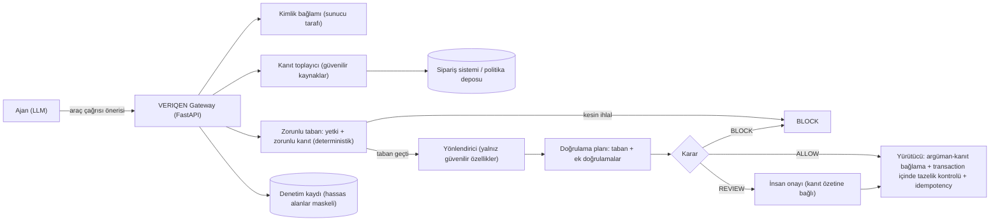

# 05 — Teknik Fizibilite

**Kısıtlar (yönergeden):** 2 adet Windows bilgisayar, 16 GB RAM, NVIDIA GPU yok, Python, Google Colab, gerektiğinde bulut LLM API'si. Büyük modelin yerelde eğitimi veya ağır çıkarımı yok.

**Genel sonuç:** Seçilen üç aday (F, G, A) **GPU'suz geliştirilebilir.** Karar motoru deterministik ve istatistiksel bileşenlerden oluşuyor. LLM yalnızca (a) test edilen ajanın kendisi, (b) B2 hakem baseline'ı ve (c) uyarlamalı saldırı üretimi için gerekiyor; bunlar API ile karşılanabilir. Dış kanıt olarak, VP-Control'ün yerel deneyleri 16 GB'lık bir dizüstünde 4–10B nicemlenmiş modellerle yürütülmüş; bu, benzer ölçekte yerel denemenin mümkün olduğunu gösteriyor (ancak yavaş: ortalama gate gecikmesi birkaç saniye).

---

## 1. Ortak mimari (üç aday için)



**Yönergedeki 10 güvenlik ilkesiyle eşleşme:**

| İlke | Tasarımdaki karşılığı |
|---|---|
| 1. Kesin yetki ihlali telafi edilemez | Zorunlu taban önce çalışır; BLOCK kararı sonraki hiçbir puanla geri alınamaz. |
| 2. LLM çıktısı tek başına yetki veremez | LLM yalnızca ajan ve (B2'de) hakem; VERIQEN kararında LLM çıktısı ALLOW üretemez. En fazla REVIEW'a yükseltebilir. |
| 3. Kritik kanıtlar güvenilir sistemden | Kanıt toplayıcı yalnızca kayıtlı kaynaklardan okur. |
| 4. Ajan beyanı kanıt değildir | Ajanın gönderdiği değerler yalnızca "karşılaştırma girdisi"dir; yönlendirmeye de girmez (Aday F). |
| 5. Kontrolü atlayarak kritik araç çağrılamaz | Yazma yetkisi yalnızca yürütücüde; ajan doğrudan sipariş sistemine yazamaz. |
| 6. Belirsiz + yüksek risk → güvenli varsayılan | Kaynak kesintisi ve zaman aşımında varsayılan REVIEW ya da BLOCK; asla ALLOW değil (bkz. 2606.14517). |
| 7. İnsan onayı doğrulanabilir | Onay; onaylayanın kimliğine, işlem kimliğine ve kanıt/parametre özetine (hash) bağlanır. |
| 8. Kararlar denetlenebilir | Karar kaydı: işlem kimliği, politika sürümü, plan kimliği, kanıt kaydı kimlikleri, gerekçe kodu. |
| 9. Hassas bilgi loglanmaz | Kayıtta ham kanıt yerine kimlik + özet; PII alanları maskeli. |
| 10. Performans optimizasyonu kuralı devre dışı bırakamaz | Monoton taban kısıtı (Aday F): yönlendirici tabanın altına plan seçemez. |

---

## 2. Aday bazında fizibilite

### Aday F — Manipülasyona dayanıklı uyarlamalı doğrulama

| Başlık | Değerlendirme |
|---|---|
| Mimari | Yukarıdaki genel mimari + yönlendiricinin girdi şeması **tip düzeyinde** iki sınıfa ayrılır: `TrustedFeature` / `UntrustedSignal`. Yönlendirici fonksiyonu yalnızca `TrustedFeature` alabilir; bu kısıt birim testle ve statik kontrolle zorlanır. Monoton taban, her işlem sınıfı için `minimum_plan` tanımı ve `assert plan ⊇ minimum_plan` kontrolüyle sağlanır. |
| Python kütüphaneleri | `fastapi`, `pydantic` (tip ayrımı), `uvicorn`, `sqlite3`/`sqlalchemy`, `pytest`, `hypothesis` (özellik tabanlı test: "güvenilmeyen kanal değişince plan değişmez"), `numpy`, `pandas`, `scipy`, `statsmodels` (McNemar, Holm), `agentdojo` (PyPI). Saldırı üretimi için resmî LLM SDK'ları. |
| LLM gereksinimi | Ajan: API LLM (en az 2 farklı sağlayıcı). Saldırgan: API LLM (uyarlamalı istem üretimi). VERIQEN karar yolunda LLM yok. |
| API kullanımı | Orta–yüksek. Uyarlamalı saldırı döngüleri çok sayıda çağrı üretir; bütçe deney öncesinde hesaplanmalı (bkz. §4). |
| CPU/RAM | Karar motoru: milisaniye düzeyi, <1 GB. AgentDojo çalıştırması: CPU yeterli, LLM çağrıları uzaktan. |
| Karmaşıklık | Orta–yüksek. En zor kısım, **anlamlı ve güçlü** uyarlamalı saldırıların tasarımı. |
| Olası güvenlik açıkları | (1) Bir özelliğin yanlışlıkla "güvenilir" sınıflanması (ör. ajanın gönderdiği sipariş kimliğinden okunan kayıt; kimlik ajan tarafından seçildiği için dolaylı etki var). (2) Kaynak sağlığı sinyalinin saldırganca bozulması ("degraded" ise ucuz yol seçen politika). (3) Zaman aşımı ile DoS. (4) Ret mesajlarının bilgi sızdırması (Causality Laundering, 2604.04035). |
| Veri kümesi / senaryo | Sentetik iade simülatörü (repo planı), AgentDojo Banking (`send_money`), τ-bench retail (iade/değişim politikaları). |
| Rakip karşılaştırma | B0–B4 + B4-naif + VP-Control tarzı portföy. |
| Başarısızlık riskleri | (a) Naif uyarlamalı sistem de saldırıya dayanıklı çıkabilir (H1a reddi). (b) Güvenilir özellik kısıtı maliyet kazancını yok edebilir. (c) Saldırılar zayıf tasarlanırsa sonuç yanıltıcı olur. |

### Aday G — Argüman düzeyinde kanıt bağlama + yürütme anı tazelik

| Başlık | Değerlendirme |
|---|---|
| Mimari | `EvidenceRecord(arg_role, value, source_id, source_version, fetched_at)`. Yürütücü, SQLite'ta `BEGIN IMMEDIATE` ile sürümü tekrar okur; `source_version` eşleşmezse işlemi iptal edip REVIEW'a döner. İdempotency anahtarı = işlem kimliği. Onay kaydı, kanıt kayıtlarının SHA-256 özetini içerir. |
| Kütüphaneler | `fastapi`, `pydantic`, `sqlite3`, `hashlib`, `pytest`, `hypothesis` (eşzamanlılık senaryoları için `threading` ile). |
| LLM gereksinimi | Yok (deterministik). Uçtan uca testte ajan için API LLM. |
| CPU/RAM | Önemsiz. |
| Karmaşıklık | Düşük–orta. |
| Olası açıklar | Kaynak sistemin sürüm alanı yoksa tazelik garantisi kurulamaz. Dağıtık sistemlerde tek transaction mümkün olmayabilir (VP-Control de bunu kapsam dışı bırakmış). |
| Senaryolar | Repodaki "değişen sipariş sürümü, yinelenen istek, doğrulama kaynağı kesintisi" senaryoları birebir kullanılabilir. |
| Başarısızlık riskleri | Bilimsel risk düşük; asıl risk "yeterince yeni değil" eleştirisi. |

### Aday A — Kanıt güvenilirliğine göre uyarlamalı doğrulama (tekrar)

| Başlık | Değerlendirme |
|---|---|
| Mimari | Yönlendirici = küçük karar tablosu ya da lojistik model. Özellikler: tutar/eşik oranı, kanıt yaşı, kaynak sağlığı, geri alınabilirlik, müşteri geçmişi (güvenilir kaynaktan). |
| Kütüphaneler | F ile aynı + `scikit-learn` (opsiyonel). |
| LLM | Ajan için API. Opsiyonel doğrulayıcı olarak küçük LLM (API ya da yerel 3–4B, Ollama). |
| CPU/RAM | Yerel 3–4B nicemlenmiş model 16 GB RAM'de çalışabilir; gecikme saniyeler düzeyinde olur. API önerilir. |
| Karmaşıklık | Düşük–orta. |
| Başarısızlık riskleri | VP-Control bulgusu bu alanda tekrarlanmayabilir (VP-Control'ün kendi FinQA denemesinde de tekrarlanmamış). |

---

## 3. Donanım ve iş bölümü önerisi (2 kişi, 2 bilgisayar)

| Bilgisayar / kişi | Sorumluluk |
|---|---|
| PC-1 | VERIQEN Gateway + karar motoru + simülatör + birim/özellik testleri (Aday G ve F'nin çekirdeği). |
| PC-2 | Deney koşucusu: AgentDojo/τ-bench entegrasyonu, saldırı üretimi, sonuç toplama ve istatistik (Aday F saldırıları ve tüm istatistik). |
| Colab | Uzun süren API deney turları (tarayıcı açık kaldığı sürece). Paralel tekrarlar. |

Windows notu: AgentDojo ve τ-bench Python paketleri Linux odaklı geliştirilmiş olabilir. **WSL2** kurulumu önerilir; bu, Windows'ta Linux ortamını GPU olmadan da sorunsuz çalıştırır.

---

## 4. API maliyeti — tahmin yöntemi

Güncel fiyatlar sık değiştiği için bu belgede dolar değeri **verilmedi.** Deneyden önce şu hesap yapılmalı:

```
Toplam maliyet ≈ Σ_model  N_bölüm × ortalama_LLM_çağrısı_per_bölüm × (girdi_token × fiyat_girdi + çıktı_token × fiyat_çıktı)
```

**Örnek bölüm sayısı (AgentDojo Banking):**

- Güvenlik vakaları: 16 kullanıcı görevi × 9 enjeksiyon görevi = **144**; zararsız vakalar: **16**
- Yöntemler: B0, B1, B2, B3, B4-naif, B4 = **6**
- Ajan LLM'i: **2** · Tekrar: **3**
- → (144 + 16) × 6 × 2 × 3 = **5.760 bölüm**

Ek olarak, uyarlamalı saldırı üretimi yalnızca B4-naif ve B4 için yapılır. Bu adım bölüm başına **k deneme** (ör. k = 10) ekler.

**Maliyeti azaltma yolları:**

- Ajan yörüngelerini bir kez üretip **dondurmak**. Karar motorları dondurulmuş araç çağrısı önerileri üzerinde karşılaştırılır; VP-Control de bu yöntemi kullanıyor. VERIQEN'in karar katmanı LLM kullanmadığı için bu tasarım çok ucuzdur.
- Uçtan uca canlı çalıştırmayı yalnızca küçük bir alt kümede yapmak.
- B2 (LLM hakemi) için küçük ve ucuz bir model kullanmak, kullanılan modeli kaydetmek.

---

## 5. Genel risk tablosu

| Risk | Olasılık | Etki | Önlem |
|---|---|---|---|
| 25 Kasım'a kadar prototip yetişmemesi | Yüksek | Orta | Başvuru için çalışan **karar motoru + 3 senaryo demo** yeterli (repo kabul ölçütü). Deneyler başvuru sonrasına planlanır. |
| VP-Control benzeri yeni bir çalışmanın F'yi de kapsaması | Orta | Yüksek | Başvurudan önce hedefli ek tarama (bkz. 07, Eksik #1). |
| API bütçesinin aşılması | Orta | Orta | Dondurulmuş yörünge + aşamalı deney. |
| Uyarlamalı saldırıların zayıf kalması | Orta | Yüksek | Nasr vd. 2025 ve Zhan vd. 2025 yöntemlerini temel almak; saldırı bütçesini raporlamak. |
| Windows uyumsuzluğu | Orta | Düşük | WSL2. |
